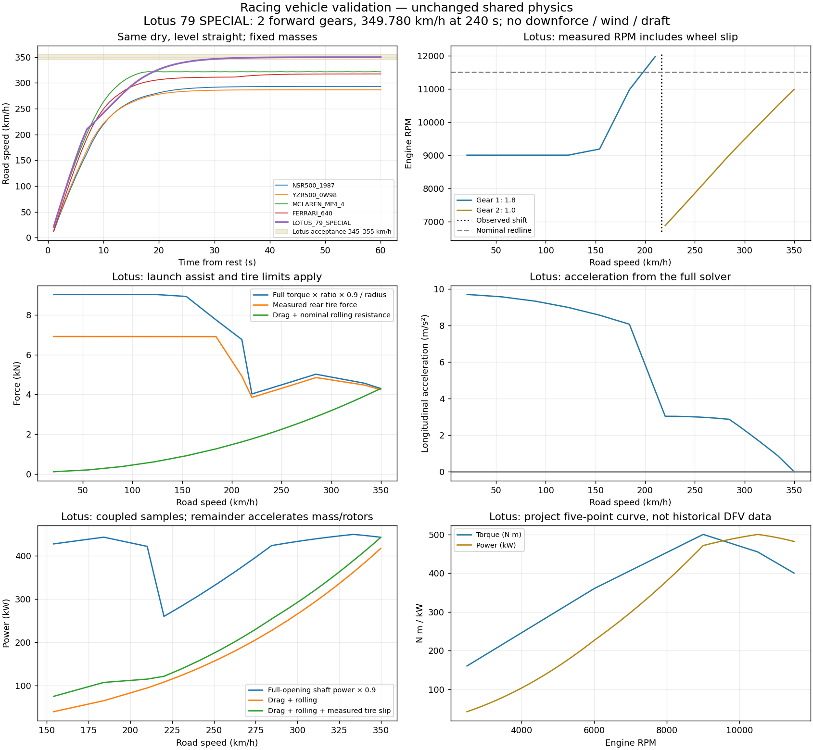
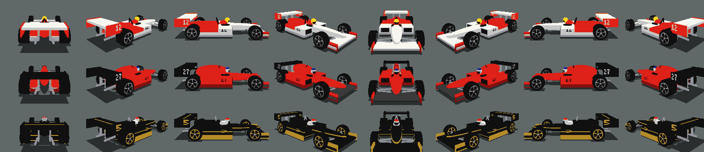
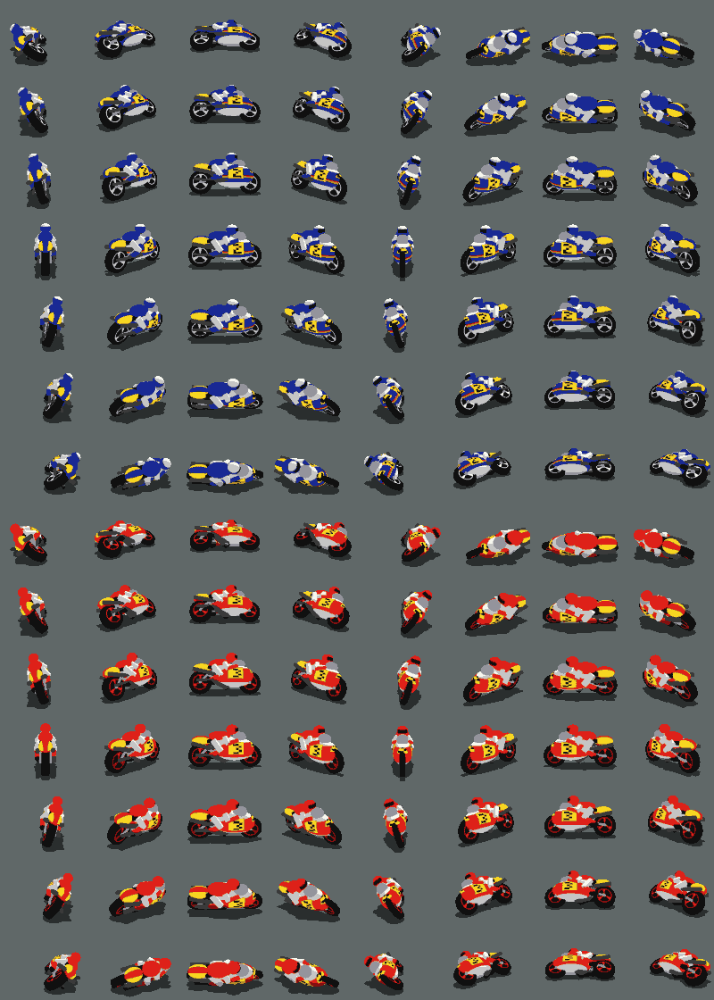
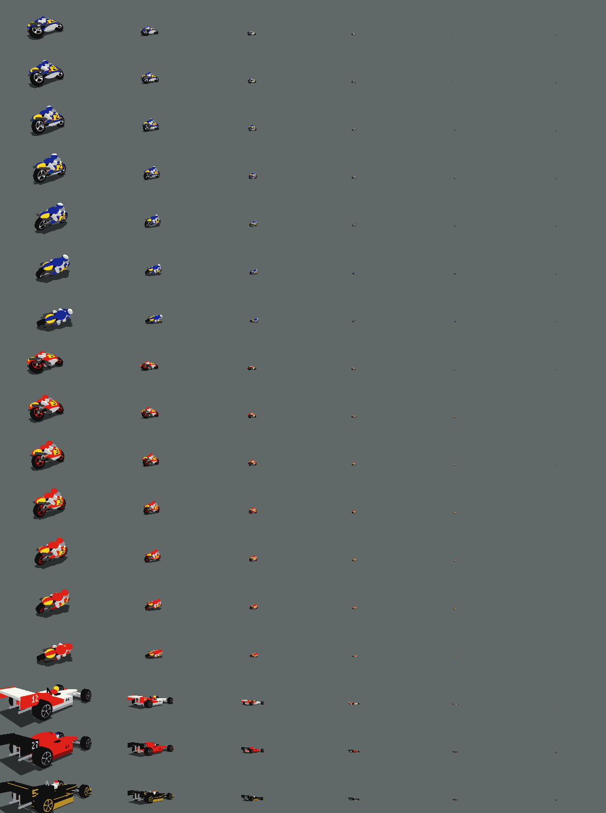

# Racing vehicle validation

Measurements use the admitted authored catalog and the unchanged product solver. `npm run racing-validation` reproduces the full traces; the delivered-catalog scenario tests repeat the key acceptance checks. [Machine-readable summary](measurements.json) and [all 1-second samples](measured-samples.csv) retain the unrounded output.

## Conditions

Flat 60,000 m straight, starting from rest at s=100 m; 240 seconds at full throttle; no other actors, wind, drafting or slope. Dry ASPHALT: grip factor 1, rolling resistance 0.014. Fixed fuel/person masses from the [ledger](../racing-vehicles.md). The ordinary 1/60 s update uses 12 physics substeps (1/720 s); existing launch assistance, wheel-slip/pitch protection, 0.9 driveline efficiency and instantaneous automatic shifts remain active. There is no downforce, new clutch model or vehicle-specific speed correction.

## Acceleration, all gears and stopping

Terminal range is the minimum/maximum road speed during the final 10 seconds. Braking starts at 240 s and ends below 0.1 m/s. Restart is eight seconds at full throttle after braking. The separate 12-second steering transient starts at 25 m/s and checks finite dynamics; existing model-check scenarios also verify steady 100 m circles and braking against planned limits.

| Vehicle            |   Terminal km/h | Gear / RPM at 240 s | 0–100 / 0–200 s | Stop from terminal: seconds / metres | Restart km/h |
| ------------------ | --------------: | ------------------: | --------------: | -----------------------------------: | -----------: |
| `NSR500_1987`      |         293.062 |         6 / 13517.4 |   4.267 / 8.733 |                       6.633 / 256.36 |       185.54 |
| `YZR500_0W98`      |         286.582 |         6 / 12650.9 |   4.117 / 8.533 |                       6.533 / 247.41 |       190.22 |
| `MCLAREN_MP4_4`    | 321.318–321.630 |         6 / 13647.1 |   3.400 / 6.950 |                       5.533 / 235.89 |       224.87 |
| `FERRARI_640`      |         317.310 |         7 / 12604.7 |   3.700 / 7.300 |                       5.417 / 226.19 |       215.69 |
| `LOTUS_79_SPECIAL` |         349.780 |         2 / 10983.3 |   3.317 / 6.567 |                       6.067 / 281.82 |       220.15 |

MP4/4 is limited by top-gear fuel-cut cycling: its instantaneous final acceleration is not zero, and the range above records the cycle. The other four reach steady power/resistance balance. These are **simulation results**, not manufacturer acceleration or speed claims. All ordinary cars reach all six/seven gears; Lotus makes exactly one upshift.

| Vehicle            | Actual ratios                         | Compiled rear rolling radius (m) | Nominal redline speeds, km/h, all gears                |
| ------------------ | ------------------------------------- | -------------------------------: | ------------------------------------------------------ |
| `NSR500_1987`      | 2.2, 1.72, 1.4, 1.21, 1.12, 1         |                           0.3180 | 141.28, 180.70, 222.01, 256.87, 277.51, 310.81         |
| `YZR500_0W98`      | 2.3, 1.8, 1.5, 1.3, 1.16, 1.05        |                           0.3100 | 132.32, 169.08, 202.89, 234.11, 262.36, 289.85         |
| `MCLAREN_MP4_4`    | 3, 2.25, 1.85, 1.55, 1.38, 1.25       |                           0.3220 | 131.51, 175.34, 213.25, 254.53, 285.88, 315.62         |
| `FERRARI_640`      | 3.2, 2.5, 2.05, 1.75, 1.52, 1.35, 1.2 |                           0.3302 | 131.29, 168.05, 204.94, 240.07, 276.40, 311.21, 350.11 |
| `LOTUS_79_SPECIAL` | 1.8, 1                                |                           0.3230 | 216.10, 388.98                                         |

Nominal speed is `rpm × 2π × rollingRadius × 60 / (gear × finalDrive × 1000)` with no wheel slip. It is a kinematic limit, not a promise of achievable speed. The solver chooses shifts from rolling speed; observed engine RPM includes wheel slip.

| Vehicle            | Measured upshifts: time s, road km/h, engine RPM before → after                                                                                                                                        |
| ------------------ | ------------------------------------------------------------------------------------------------------------------------------------------------------------------------------------------------------ |
| `NSR500_1987`      | 1→2: 6.283, 146.14, 14666→11479; 2→3: 7.767, 181.23, 14457→11769; 3→4: 10.200, 222.26, 14401→12447; 4→5: 13.900, 257.10, 14365→13297; 5→6: 18.850, 277.67, 14348→12811                                 |
| `YZR500_0W98`      | 1→2: 5.700, 137.02, 13007→10163; 2→3: 7.000, 169.59, 12922→10770; 3→4: 8.733, 203.19, 12875→11160; 4→5: 11.167, 234.35, 12842→11460; 5→6: 15.217, 262.59, 12817→11602                                  |
| `MCLAREN_MP4_4`    | 1→2: 4.433, 131.74, 13645→10237; 2→3: 6.000, 175.77, 13646→11222; 3→4: 7.500, 213.40, 13647→11436; 4→5: 9.483, 254.78, 13506→12025; 5→6: 11.700, 285.98, 13446→12179                                   |
| `FERRARI_640`      | 1→2: 4.733, 131.56, 14170→11073; 2→3: 6.050, 168.49, 14172→11623; 3→4: 7.533, 205.30, 14061→12004; 4→5: 9.383, 240.31, 13975→12139; 5→6: 12.600, 276.47, 13926→12369; 6→7: 33.817, 311.21, 13894→12350 |
| `LOTUS_79_SPECIAL` | 1→2: 7.633, 216.21, 12033→6693                                                                                                                                                                         |

## Torque, mass placement and resistance checks

The test evaluates every curve endpoint and each in-segment stationary point of `P(rpm)=rpm×(a×rpm+b)×2π/60000`. Peak power stays at point D; no interior peak exceeds its adopted value. Torque stays positive and continuous.

| Vehicle            | A–E: RPM / N m                                                                              | Peak power kW | Static front load share | Yaw / pitch mass radius m | Equivalent CdA m² |
| ------------------ | ------------------------------------------------------------------------------------------- | ------------: | ----------------------: | ------------------------: | ----------------: |
| `NSR500_1987`      | 2500 / 16.00000; 8000 / 43.00000; 11500 / 90.00000; 13000 / 84.28195; 14000 / 76.00000      |    114.737807 |                  47.14% |             0.654 / 0.720 |          0.293878 |
| `YZR500_0W98`      | 2500 / 17.00000; 7800 / 45.00000; 10500 / 94.00000; 11500 / 91.61081; 12500 / 81.50000      |    110.324808 |                  47.86% |             0.654 / 0.720 |          0.293878 |
| `MCLAREN_MP4_4`    | 3000 / 110.00000; 8000 / 400.00000; 10000 / 424.37102; 12500 / 384.88756; 13000 / 360.00000 |    503.816638 |                  44.35% |             1.181 / 1.100 |          0.816327 |
| `FERRARI_640`      | 3000 / 150.00000; 7000 / 250.00000; 11000 / 355.00000; 12500 / 336.89918; 13500 / 300.00000 |    440.999995 |                  43.86% |             1.183 / 1.104 |          0.897959 |
| `LOTUS_79_SPECIAL` | 2500 / 160.00000; 6000 / 360.00000; 9000 / 500.00000; 10500 / 454.72841; 11500 / 400.00000  |    500.000001 |                  42.59% |             1.200 / 1.125 |          0.726531 |

Decimals in calculated torque and derived results are retained for reproducibility, not measurement precision. Inertial mass radii are `sqrt(I/m)`; CdA is the equivalent `2q/1.225` for the authored quadratic drag. None supplies missing downforce.

## Lotus feasibility

| Quantity                                 | Fixed design or measured result                                                                               |
| ---------------------------------------- | ------------------------------------------------------------------------------------------------------------- |
| Rear rolling radius                      | 0.323 m                                                                                                       |
| Final reduction                          | 3.6, applied once; driveline efficiency 0.9 once                                                              |
| 1st / 2nd                                | 1.8 / 1.0; exactly two array entries                                                                          |
| Nominal shift / post-shift RPM           | 11,500 / 6388.889, from 11500 × 1/1.8                                                                         |
| Measured shift                           | 7.633 s, 216.209 km/h; 12033.198 → 6692.778 rpm                                                               |
| Ideal ratio from measured pre-shift RPM  | 6685.110 rpm; observed post-shift includes the intervening wheel/clutch state update                          |
| Torque at nominal 6388.889 RPM           | 378.148 N m, rising band; sufficient second-gear acceleration                                                 |
| 1st / 2nd nominal redline speed          | 216.101 / 388.982 km/h                                                                                        |
| 345 km/h reached                         | 28.350 s, 1981.010 m                                                                                          |
| 349 km/h reached                         | 37.667 s, 2880.523 m                                                                                          |
| Terminal road speed                      | 349.779629 km/h, inside 345–355                                                                               |
| Measurement length                       | 240 s, 22538.325 m from rest                                                                                  |
| Terminal engine state                    | 10983.265 rpm, gear 2, full effective opening, locked existing clutch, no fuel cut                            |
| Terminal acceleration                    | 0.000000 m/s²; stable during final 10 s                                                                       |
| Full-opening shaft / wheel power         | 492.593 / 443.333 kW                                                                                          |
| Drag / rolling / measured tire slip loss | 408.165 / 9.271 / 25.561 kW                                                                                   |
| Power residual                           | 0.336 kW (0.076%); nominal rolling term and sampled contact geometry/numerics                                 |
| Limiting mechanism                       | Available power versus drag, rolling resistance and tire slip; not top-gear redline, forced speed or new aero |

The actual 1→2 shift occurs when zero-slip rolling RPM reaches redline; the engine is faster because the driven tire slips. The observed before/after speeds therefore differ from the nominal 11,500→6388.889 calculation. The upper curve remains within the existing 1.05-redline fuel-cut rule. “Wheel power” in the plot is the full-opening net engine curve × 0.9; before clutch lock or under torque protection it is potential power, not delivered road power. Rear tire force is reconstructed from the solver’s measured slip power divided by slip speed. Tire slip loss is read from accepted tire observations, not invented to close the balance.

[Standalone SVG](performance.svg). The first panel compares all five. The other panels show Lotus RPM/gears, available force and measured rear tire force, acceleration, power balance after coupling, and the project torque/power curve.

## Picture review

Saved sets contain 448 pictures per bike (64 yaw × 7 banks) and 64 per car, each with six sizes and a separate shadow. Total: **6528 picture sizes**. All sets admit through the common sprite reader; all frame/shadow anchors share its texel grid. No picture uses brake-lamp slot 15. Geometry, body colors, wheel contact, silhouette orientation, shadows and number orientation were inspected in the complete direction/bank sheets and these overview sheets. A first bake had reversed side-number textures; both sides were corrected independently before the final bake.

The native-size final LOD is subpixel in some head-on bike directions: **21 NSR and 19 YZR size-5 cells become transparent under the shared half-texel coverage rule**. They remain valid declared frames; no frame or bank is missing. Sizes 0–4 are visible in every direction/bank, and all car sizes are visible. No private minimum-size or camera exception was added.

Cars: MP4/4, Ferrari 640, Lotus 79, top to bottom. Each row shows yaw indices 0,8,…56.

Bikes: NSR above YZR. Each has all seven banks, −60° to +60°, top to bottom; columns are yaw 0,8,…56. Exhaust geometry is authored per side, not mirrored.

LOD columns 0–5 at yaw 8, every bike bank followed by the three cars. All 64-yaw sheets are regenerated by `npm run racing-pictures -- all replace` under `dist/racing-pictures/`. Independent fresh processes regenerated the five sprite JSONs byte-for-byte; SHA-256 values are recorded below; each name opens its complete size-0 PNG sheet.

| Sprite set                               | SHA-256                                                            |
| ---------------------------------------- | ------------------------------------------------------------------ |
| [nsr500-1987](nsr500-1987.png)           | `ef7f38aee6294969de61bad1d9d47c43847acec99b8445733643191472fc0383` |
| [yzr500-0w98](yzr500-0w98.png)           | `d85a27b6f7035d14847fdac4b07adcc9cca5c5069addeec94bb4b958338051c0` |
| [mclaren-mp4-4](mclaren-mp4-4.png)       | `2014fdb3bc353589156ae770e39ed99e6e04dc7fbfb8c07b22c2646a9d9af66d` |
| [ferrari-640](ferrari-640.png)           | `c3ae69cb25fa2f4f417908819e15f5430abdf4d54f26c47d9ac5c53a138141e7` |
| [lotus-79-special](lotus-79-special.png) | `089fde594d0be8fce17a9620be04aa6ca09dbd93581c202a981c9576789370db` |

## Release checks

The delivered-catalog tests cover selection/three information pages for every catalog entry, FREE PLAY start/render/reset for each new vehicle, units and true curve maxima, every upshift, braking, restart and finite steering transients. The actual Lotus listing is tested against a stationary wall: one explosion, stopped state, safe recovery, no added gate credit and fresh-run reset. Each ordinary racing listing keeps normal solid contact. The shared response tests additionally cover another vehicle at rest, all solid counterpart paths, occupied recovery and protection, and sound deduplication.

The wider F1 catalog raises the common maximum vehicle footprint. The standard measurement command regenerates racing lines and reference times that depend on it; series membership and authored run conditions remain unchanged. Sound loudness uses the existing 48 kHz BS.1770 procedure.

Node 24.19.0 `npm test` passed all 114 tests and the four dependency checks, with no failures or skips. The generated shared-scene FREE PLAY frames for all five and the Lotus selection page were inspected. The standard `npm run measure -- generate` then has no stale jobs or extra files. The existing numeric gear-position display is unchanged.
